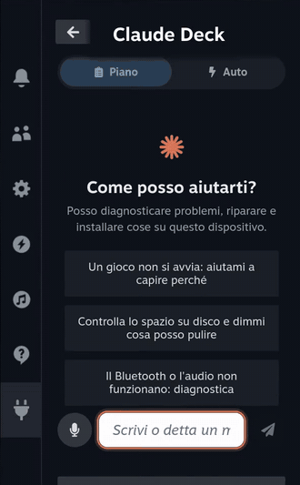
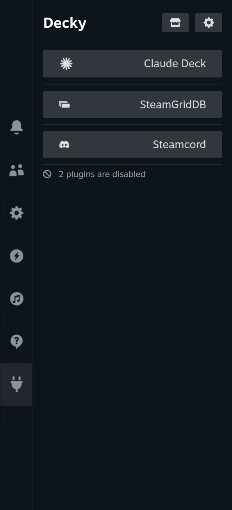
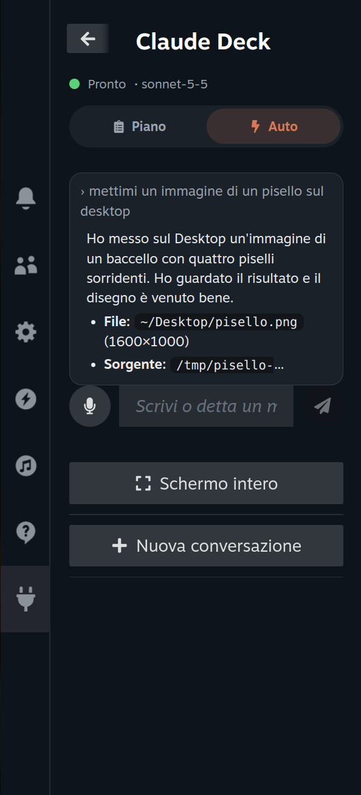
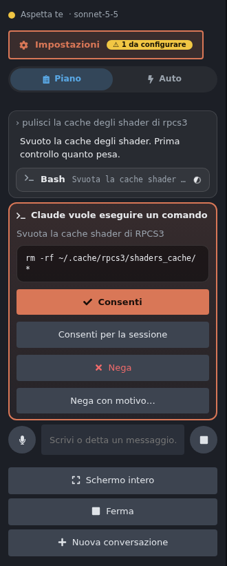
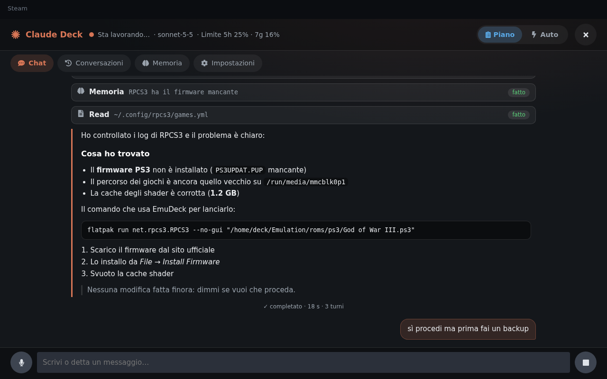
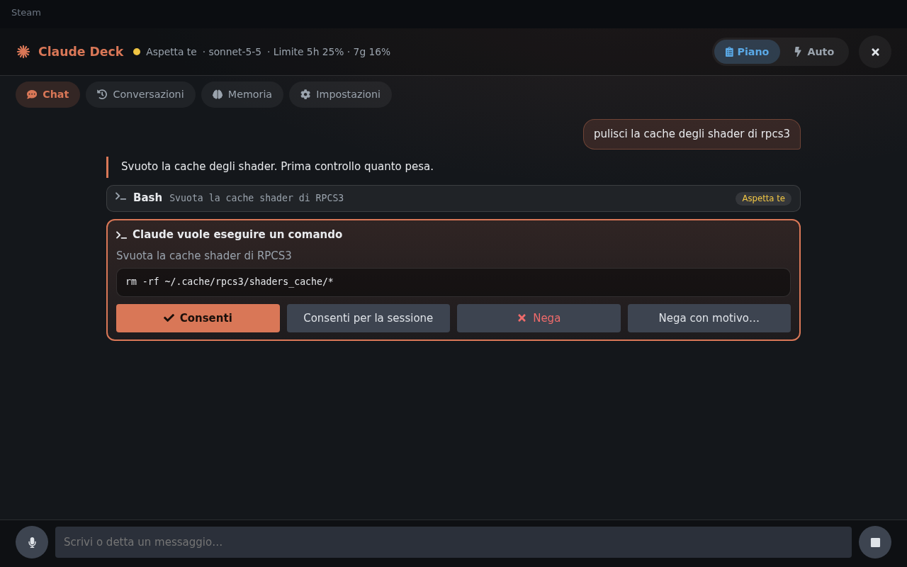
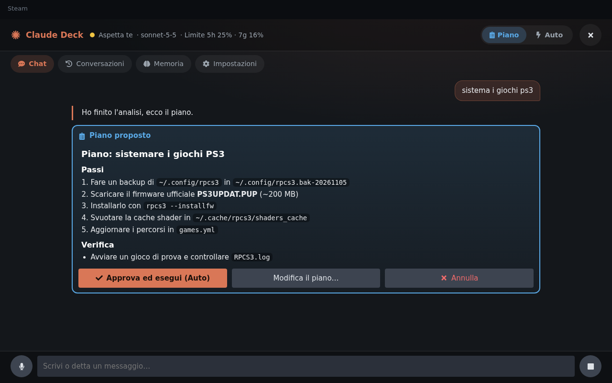
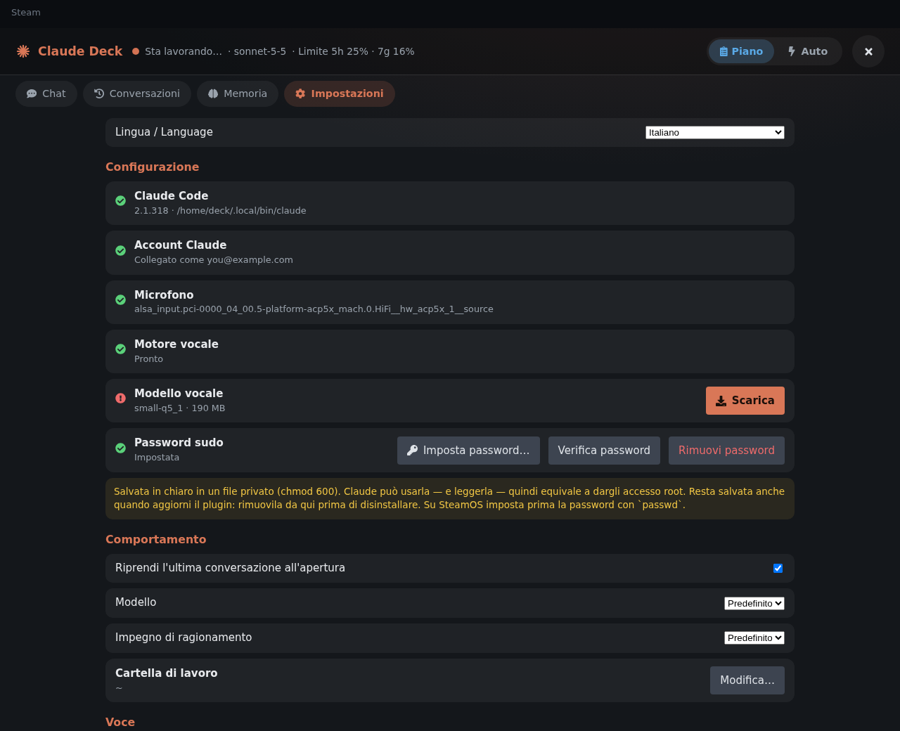
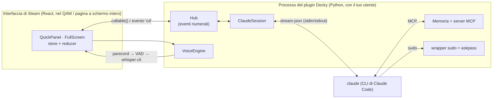

<div align="center">

# Claude Deck

**Claude Code nel Quick Access Menu del tuo Steam Deck.**
Diagnostica, ripara, configura e installa cose su SteamOS / Bazzite parlando (o scrivendo) con un agente AI, tutto con il gamepad.

[](https://github.com/loddi-o/claude-deck/actions/workflows/build.yml)
[](https://github.com/loddi-o/claude-deck/releases/latest)
[](LICENSE)

[English](README.md) · **Italiano**



<sub>Registrazione reale su SteamOS. <a href="docs/media/demo.mp4">Guarda il video completo (96 secondi)</a>.</sub>

</div>

---

## Indice

- [Cosa fa](#cosa-fa)
- [Screenshot](#screenshot)
- [Come funziona](#come-funziona)
- [Requisiti](#requisiti)
- [Installazione](#installazione)
- [Come si usa](#come-si-usa)
- [Aggiornare e disinstallare](#aggiornare-e-disinstallare)
- [Privacy e sicurezza](#privacy-e-sicurezza)
- [Dove stanno i dati](#dove-stanno-i-dati)
- [Risoluzione dei problemi](#risoluzione-dei-problemi)
- [Sviluppo](#sviluppo)
- [Limiti noti](#limiti-noti)
- [Licenza](#licenza)

## Cosa fa

Claude Deck è un plugin [Decky Loader](https://decky.xyz). Esegue il tuo **Claude Code locale** (`claude`) come *agente* dal Quick Access Menu (QAM), così puoi dire cose come:

> *«Un gioco non si avvia, aiutami a capire perché»* · *«Controlla lo spazio su disco e dimmi cosa posso pulire»* · *«L'audio Bluetooth scatta»* · *«Installa fastfetch e mostrami le info di sistema»*

e Claude legge log e file di sistema, esegue comandi, modifica la configurazione e installa software su **questo** dispositivo, chiedendoti conferma prima di fare qualsiasi cosa importante.

- **Un vero agente, non una chat.** Tutti gli strumenti di Claude Code: lettura di file (anche di sistema), comandi shell, modifica e scrittura di file, installazione di pacchetti, con supporto a `sudo`.
- **Pensato per il controller.** Un pannello compatto nel QAM per l'uso rapido e una pagina a **schermo intero** (Chat · Conversazioni · Memoria · Impostazioni). Tutto si raggiunge con D-pad, A/B/X/Y e L1/R1; funziona anche con la tastiera fisica. Per scrivere usa la tastiera a schermo di Steam.
- **Modalità Piano e Auto.**
  - **Piano**: Claude indaga in sola lettura e ti propone un piano. Lo approvi (o lo fai correggere) con un tocco.
  - **Auto**: Claude agisce in autonomia con la modalità di permessi `auto` di Claude Code, che blocca le azioni rischiose. Ciò che richiede ancora una decisione compare come card.
- **Conferme a pulsante.** Ogni richiesta di permesso, piano e domanda a scelta multipla di Claude diventa una card: *Consenti* · *Consenti per la sessione* · *Nega* · *Nega con motivo*.
- **Dettatura vocale (solo voce → testo).** Tocca il microfono, parla, e il testo compare nel campo messaggio da rivedere. Il riconoscimento è **offline** ([whisper.cpp](https://github.com/ggml-org/whisper.cpp)): l'audio non lascia mai il dispositivo.
- **Memoria.** Riprende l'ultima conversazione all'apertura, elenca quelle passate e tiene una **memoria persistente** (`memory.md`) che Claude legge a ogni nuova conversazione e aggiorna da solo (fix che hanno funzionato, pacchetti installati, particolarità dell'hardware).
- **Sa dove si trova.** Il prompt di sistema cambia per SteamOS (rootfs read-only, Flatpak, distrobox, `steamos-readonly`) e per Bazzite (`ujust`, `rpm-ostree`, Homebrew), e avvisa Claude di ciò che chiuderebbe la sua stessa interfaccia (riavviare Decky o Steam).
- **Italiano e inglese.** L'interfaccia segue la lingua di Steam (inglese se non supportata) e si cambia da *Impostazioni → Lingua / Language*. Claude risponde nella tua lingua.
- **Notifiche.** Se Claude ha bisogno di te a menu chiuso, ricevi una notifica di Steam.

## Screenshot

**Screenshot reali** da SteamOS (Steam Big Picture):

<p align="center">
  
  &nbsp;&nbsp;
  
</p>

**Anteprime dell'interfaccia.** Generate dall'harness di test della repo con dati di esempio; l'impaginazione è quella reale.

| | |
|---|---|
|  |  |
| *Pannello QAM: pulsante Impostazioni in alto (con il badge «da configurare»), selettore Piano/Auto, una richiesta di permesso.* | *Chat a schermo intero: chiamate agli strumenti, markdown, risposte in streaming.* |
|  |  |
| *Card di permesso: Consenti · Consenti per la sessione · Nega · Nega con motivo.* | *Modalità Piano: leggi il piano, poi approva, modifica o annulla.* |
|  | |
| *Impostazioni: lingua, checklist (Claude, login, microfono, motore e modello vocale, sudo), comportamento, voce.* | |

## Come funziona



**L'agente.** Il backend (`main.py` + `py_modules/claude_deck/`, solo libreria standard) avvia `claude` come processo figlio persistente in modalità `stream-json`:

```
claude --input-format stream-json --output-format stream-json --verbose --include-partial-messages \
       --permission-prompt-tool stdio --permission-mode plan|auto \
       --resume <sessione> --append-system-prompt <prompt di sistema + memoria> \
       --mcp-config <server memoria> --allowedTools <diagnostica in sola lettura> --add-dir /etc /var /usr …
```

Traduce il protocollo in eventi per l'interfaccia: testo in streaming, chiamate agli strumenti con il loro output e richieste di permesso (`can_use_tool`). Il tuo tocco su *Consenti* o *Nega* torna indietro come `control_response`. È lo stesso protocollo dell'SDK ufficiale Claude Agent.

**Permessi.** In modalità *Piano* Claude resta in sola lettura finché non approvi il piano (`ExitPlanMode` → card del piano; *Approva* passa ad Auto). In modalità *Auto* è il classificatore di Claude Code a bloccare le azioni rischiose. *Consenti per la sessione* riusa i suggerimenti di permesso di Claude Code ma li forza a valere solo per la sessione: nulla viene scritto nelle tue impostazioni permanenti. Un insieme di diagnostiche in sola lettura (`journalctl`, `lsblk`, `pacman -Q`, …) è pre-approvato, così il Piano non è un muro di richieste.

**Memoria.**
1. *Conversazioni*: le trascrizioni di Claude Code (`~/.claude/projects/…`) vengono elencate e si possono riprendere; l'ultima si riapre da sola.
2. *Memoria persistente*: `memory.md` viene iniettato nel prompt di sistema di ogni nuova conversazione. Claude lo aggiorna con tre strumenti (`remember`, `recall`, `forget`) esposti da un piccolo server MCP incluso nel plugin; dalla pagina Memoria puoi leggere, aggiungere ed eliminare note.

**Voce.** `parecord` (ripiego su `pw-record` / `arecord`) cattura audio mono a 16 kHz, un piccolo rilevatore di attività vocale a energia chiude la registrazione quando smetti di parlare, e `whisper-cli` statico incluso lo trascrive. Il modello (`small-q5_1`, ~190 MB, multilingue) si scarica una volta da Hugging Face, su richiesta. Il risultato finisce nel campo messaggio; nulla viene letto ad alta voce.

**`sudo`.** L'agente non ha un terminale: `bin/sudo` (primo nel suo `PATH`) chiama `sudo -A` e `bin/askpass` stampa la password che hai salvato. Senza password salvata Claude lavora solo in user-space (Flatpak, distrobox, `~/.local`, servizi utente…).

**Interfaccia resiliente.** Tutto lo stato sta in uno store a livello di modulo che sopravvive alla chiusura del QAM, gli eventi sono numerati così un'interfaccia riaperta si risincronizza da uno snapshot, e un processo `claude` andato in crash viene riavviato con `--resume`.

Più dettagli in [docs/ARCHITECTURE.md](docs/ARCHITECTURE.md).

## Requisiti

- **SteamOS** (o una distro simile come **Bazzite**) x86-64 con **[Decky Loader](https://decky.xyz)** (sviluppato su 3.3.1; il backend gira nel suo Python 3.14 incorporato, senza pacchetti pip).
- **Claude Code** installato e collegato al tuo account Anthropic (sviluppato su 2.1.318). Il plugin può installarlo e avviare l'accesso dalle *Impostazioni*, ma vedi i [limiti noti](#limiti-noti).
- Accesso a Internet (Claude Code parla con Anthropic; il modello vocale si scarica una volta).
- Per la voce: un microfono (quello integrato del Steam Deck va bene) e una CPU con AVX2 — qualsiasi Steam Deck, ROG Ally o Legion Go.
- Facoltativa ma consigliata: una password per l'utente `deck` (`passwd`), così Claude può usare `sudo`.

> Sviluppato e provato su SteamOS in esecuzione su una scheda AMD BC-250 con Decky Loader 3.3.1. **Non** è ancora stato provato su uno Steam Deck fisico, su altri handheld né su Bazzite (per ora il supporto a Bazzite sta solo nel prompt di sistema).

## Installazione

### 1. Installa Decky Loader
Segui [decky.xyz](https://decky.xyz) se non ce l'hai ancora.

### 2. Prepara Claude Code
In Desktop Mode apri Konsole ed esegui:

```bash
curl -fsSL https://claude.ai/install.sh | bash
claude        # esegui l'accesso una volta, poi esci
```

(Oppure salta questo passaggio e usa poi i pulsanti *Installa* / *Accedi* nelle Impostazioni del plugin.)

### 3. Scarica il plugin
Prendi **`claude-deck-vX.Y.Z.zip`** dall'[ultima release](https://github.com/loddi-o/claude-deck/releases/latest). Se vuoi, verificalo:

```bash
sha256sum claude-deck-v*.zip     # confronta con il checksum nelle note della release
```

### 4. Installalo dallo ZIP
1. In Game Mode apri il QAM → **Decky** → ⚙ **Impostazioni** → **Generale** e attiva la **Modalità sviluppatore**.
2. Vai nella nuova sezione **Sviluppatore** → **Installa plugin da ZIP** e scegli il file (è in `Download`).
   *(I nomi dei menu possono variare leggermente tra le versioni di Decky.)*
3. Apri il QAM → **Claude Deck**.

<sub>In alternativa, da un clone della repo in Desktop Mode: `scripts/build.sh && scripts/dev-install.sh` (serve `sudo`; riavvia Decky).</sub>

### 5. Primo avvio
Premi **Impostazioni** in cima al pannello (il badge ⚠ dice quante cose essenziali mancano) e percorri la checklist:

| Voce | Cosa fare |
|---|---|
| **Lingua** | Di default segue la lingua di Steam; cambiala qui se vuoi. |
| **Claude Code / Account** | Installa / accedi da qui se non l'hai già fatto. |
| **Password sudo** | Su SteamOS l'utente `deck` non ha password finché non esegui `passwd` in Konsole. Impostala, poi inseriscila qui con la tastiera a schermo. Saltala per tenere Claude fuori dalle operazioni da root. |
| **Motore / Modello vocale** | Il motore è incluso nel plugin. Premi **Scarica** per il modello vocale (una volta sola). |
| **Microfono** | Rilevato in automatico; collega un microfono USB/Bluetooth se il dispositivo non ne ha. |

Poi prova uno dei suggerimenti nella schermata di benvenuto.

## Come si usa

**Controller** (la barra dei suggerimenti in basso mostra sempre il tasto giusto per ciò che hai selezionato):

| Azione | Pulsante |
|---|---|
| Muoversi tra messaggi, card e pulsanti | D-pad |
| Selezionare / espandere l'output di uno strumento | **A** |
| Indietro / chiudere la pagina a schermo intero | **B** |
| Dettare (sul campo messaggio) · *Consenti per la sessione* (su una richiesta di permesso) | **X** |
| Alternare **Piano ⇄ Auto** (sul campo messaggio) · *Nega con motivo* (su una richiesta di permesso) | **Y** |
| Cambiare scheda nella pagina a schermo intero | **L1 / R1** |
| Scorrere testi lunghi | D-pad (blocco per blocco), stick destro / trackpad |

**Tastiera:** `Invio` invia · `Ctrl+M` Piano/Auto · `Ctrl+N` nuova conversazione · `Ctrl+D` detta · `Ctrl+Tab` scheda successiva · `Esc` annulla la dettatura · `PgSu/PgGiù/Fine` scorrono la chat.

**Buone abitudini**
- Parti dal **Piano** per tutto ciò di cui non sei sicuro; passa ad **Auto** quando ti fidi del compito.
- Chiedi a Claude di *ricordare* le cose («ricorda che questo dispositivo non ha il microfono»): vengono salvate nella memoria persistente.
- A Claude è chiesto di fare backup prima di modificare i file e di domandare prima di toccare salvataggi di gioco o prefix Proton. Sono istruzioni, non garanzie: tieni i tuoi backup.

## Aggiornare e disinstallare

- **Aggiornare**: installa il nuovo ZIP allo stesso modo. Impostazioni, memoria, conversazioni e (dalla 0.1.1) la password sudo salvata restano. *(Il passaggio dalla 0.1.0 alla 0.1.1 cancella la password una volta sola: reinseriscila.)*
- **Disinstallare**: prima premi **Rimuovi password** nelle Impostazioni, se ne hai salvata una, poi disinstalla da Decky. Le cartelle dei dati qui sotto non vengono cancellate in automatico.

## Privacy e sicurezza

Claude Deck permette a un agente AI di **eseguire comandi sul tuo dispositivo**. È lo scopo del plugin, ma leggi qui:

- In modalità **Piano** non cambia nulla finché non approvi. In modalità **Auto** Claude agisce da solo: usala quando ti fidi del compito.
- La **password sudo**, se la salvi, resta in chiaro in un file `chmod 600`. Claude può usarla — e leggerla — quindi equivale a dargli **accesso root**. La puoi rimuovere quando vuoi.
- I tuoi messaggi e l'output dei comandi vengono inviati ad Anthropic da Claude Code, come in qualsiasi sessione di Claude Code. **L'audio della dettatura resta sul dispositivo.**
- Le modifiche al rootfs di SteamOS (`pacman`, `/usr`) vengono cancellate dagli aggiornamenti di SteamOS: a Claude è chiesto di preferire Flatpak, distrobox e `~/.local`.
- Nessuna telemetria, nessun server aggiuntivo: le uniche chiamate di rete sono quelle di Claude Code e il download una tantum del modello vocale.

## Dove stanno i dati

| Cosa | Dove |
|---|---|
| Impostazioni, memoria, password sudo | `~/homebrew/settings/claude-deck/` |
| Modelli vocali | `~/homebrew/data/claude-deck/models/` |
| Log del plugin | `~/homebrew/logs/claude-deck/` |
| Conversazioni | `~/.claude/projects/` (quelle di Claude Code stesso) |

Per azzerare tutto, cancella `~/homebrew/settings/claude-deck/` (e la cartella dei dati per i modelli).

## Risoluzione dei problemi

| Problema | Cosa fare |
|---|---|
| *«Claude Code non è installato»* | Usa **Installa** nelle Impostazioni, oppure esegui in Konsole il comando di installazione qui sopra. |
| **Il download del modello vocale fallisce con `CERTIFICATE_VERIFY_FAILED`** | Corretto nella **0.1.2**: aggiorna il plugin. |
| *Microfono: non rilevato / «nessun audio»* | Controlla l'ingresso predefinito (`pactl list short sources`) e che non sia silenziato. |
| **Auto** compare come `Auto*` | La modalità Auto non è disponibile per il tuo account; il plugin passa a «Accetta modifiche» e te lo segnala. |
| La conversazione si è interrotta dopo un riavvio di Decky/Steam | Normale se Claude li ha riavviati. Scrivi un messaggio: riprende da dove era. |
| Il plugin non compare | Riavvia Decky Loader (o il dispositivo) e controlla `~/homebrew/logs/`. |
| Altro | Apri una [issue](https://github.com/loddi-o/claude-deck/issues) allegando `~/homebrew/logs/claude-deck/*.log`. |

## Sviluppo

```bash
scripts/setup-node.sh        # Node 22 + pnpm 9 in ~/.cache (senza sudo)
scripts/build.sh             # typecheck + test frontend + test backend + bundle
scripts/build-whisper.sh     # whisper.cpp statico (AVX2) -> bin/whisper-cli   (servono gcc, cmake, git)
scripts/package.sh           # -> ../claude-deck-vX.Y.Z.zip
scripts/ui-shots.sh          # genera screenshot della GUI in Chrome headless con Decky simulato (IT/EN)
python3 scripts/e2e_real_claude.py   # prova end-to-end contro il vero `claude` (pochi turni economici)
```

```
main.py                    backend Decky (l'API che chiama la UI)
py_modules/claude_deck/    session, protocol, voice, memory (+MCP), sudo, prompts, hub, …
src/                       frontend React: store, reducer puro, componenti, pagine, i18n
bin/                       wrapper sudo, askpass, whisper-cli (statico)
defaults/                  template del prompt di sistema, seed della memoria
tests/                     backend (unittest + claude finto), frontend (vitest), harness della UI
docs/                      ARCHITECTURE.md e materiale del README
```

Backend: Python ≥ 3.10, solo libreria standard. Frontend: React, `@decky/ui`, `@decky/api`, Rollup. La CI compila, testa e impacchetta a ogni push.

## Limiti noti

- Sviluppato su una scheda BC-250, non ancora su uno Steam Deck fisico, altri handheld o Bazzite.
- Gli helper **Installa Claude Code** e **Accedi** inclusi sono "best effort" e non sono stati provati su una macchina senza login; se non funzionano, fai il passaggio 2 in Konsole.
- La dettatura è stata verificata con whisper.cpp reale su audio inglese e con un microfono simulato; non è ancora stata provata con un microfono fisico né con parlato italiano. Imposta *Lingua dettatura* in modo esplicito se il rilevamento automatico sbaglia.
- La modalità *Auto* dipende dal tuo account Claude.
- La pagina Impostazioni si apre come pagina a schermo intero (non dentro lo stretto pannello del QAM).

## Licenza

[MIT](LICENSE). I componenti di terze parti (whisper.cpp, icone Font Awesome, librerie Decky) sono elencati in [THIRD_PARTY_NOTICES.md](THIRD_PARTY_NOTICES.md).

*Claude è un marchio di Anthropic; Steam e Steam Deck sono marchi di Valve. Questo progetto non è affiliato né approvato da nessuna delle due.*
