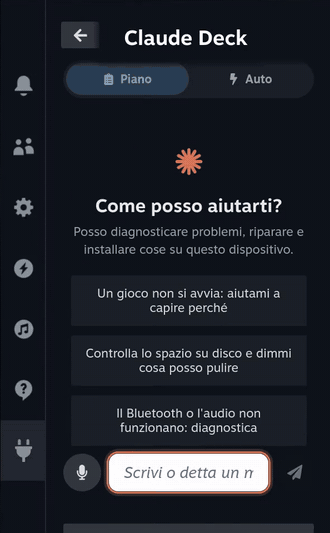
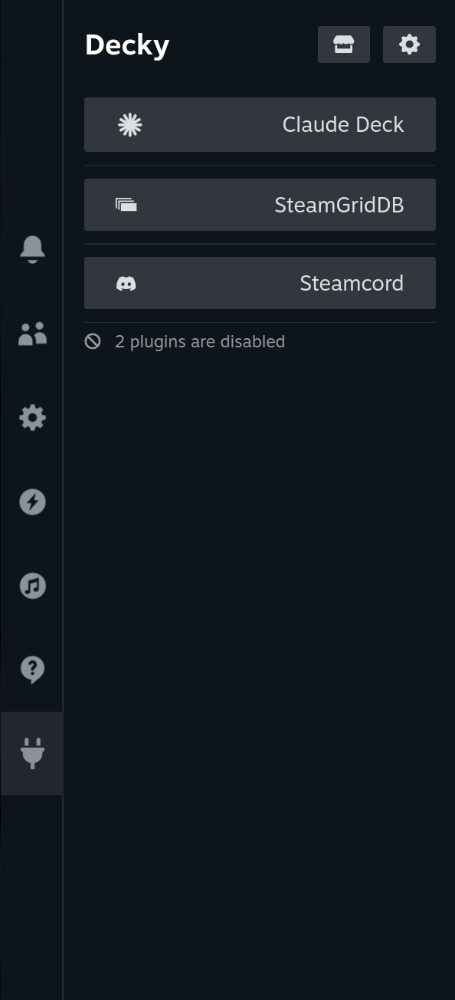
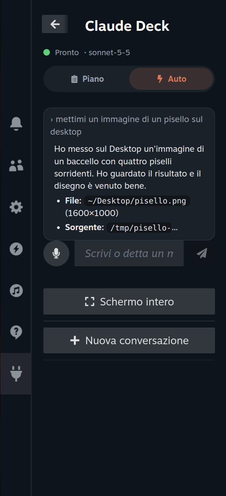
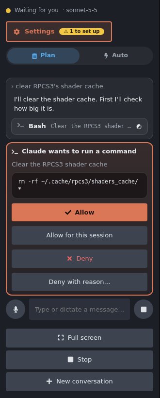
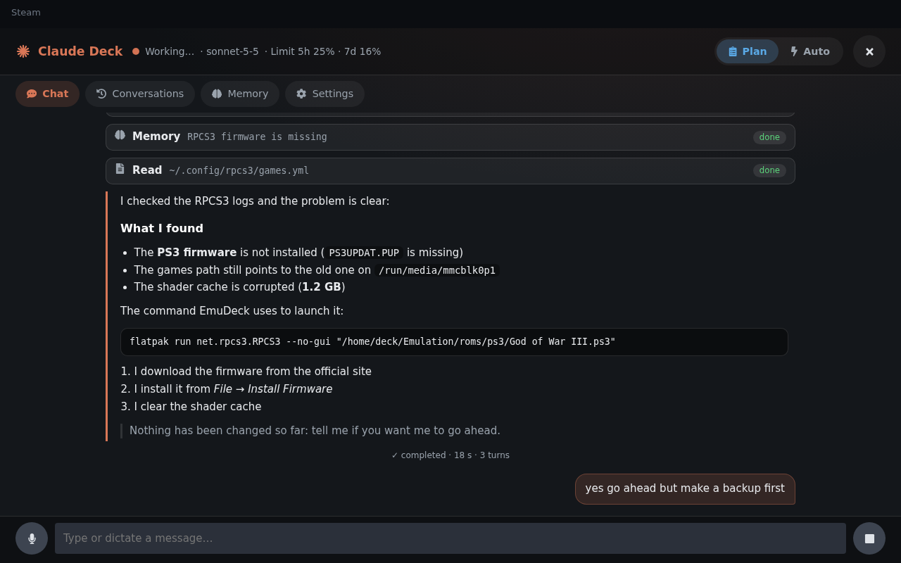
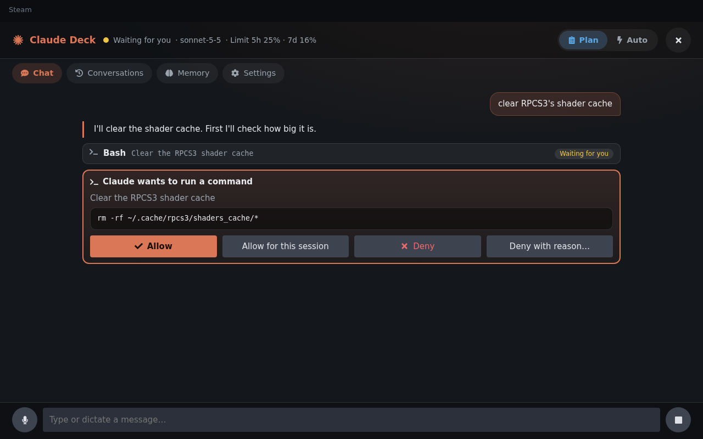
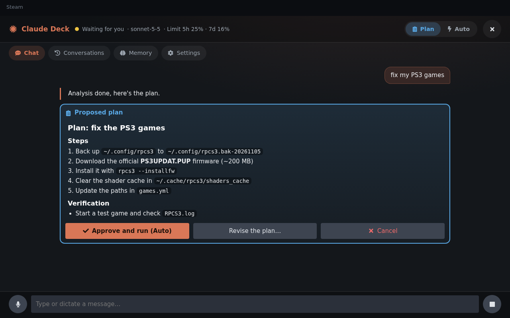
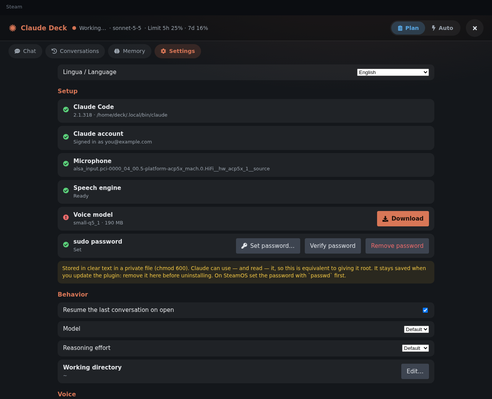
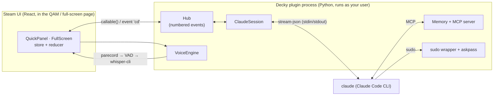

<div align="center">

# Claude Deck

**Claude Code in your Steam Deck's Quick Access Menu.**
Troubleshoot, repair, configure and install things on SteamOS / Bazzite by talking (or typing) to an AI agent, entirely with the gamepad.

[](https://github.com/loddi-o/claude-deck/actions/workflows/build.yml)
[](https://github.com/loddi-o/claude-deck/releases/latest)
[](LICENSE)

**English** · [Italiano](README.it.md)



<sub>Real recording on SteamOS (Italian UI). <a href="docs/media/demo.mp4">Watch the full 96-second video</a>.</sub>

</div>

---

## Contents

- [What it does](#what-it-does)
- [Screenshots](#screenshots)
- [How it works](#how-it-works)
- [Requirements](#requirements)
- [Installation](#installation)
- [Using it](#using-it)
- [Updating and uninstalling](#updating-and-uninstalling)
- [Privacy and security](#privacy-and-security)
- [Where your data lives](#where-your-data-lives)
- [Troubleshooting](#troubleshooting)
- [Development](#development)
- [Known limitations](#known-limitations)
- [License](#license)

## What it does

Claude Deck is a [Decky Loader](https://decky.xyz) plugin. It runs your **local Claude Code** (`claude`) as an *agent* from the Quick Access Menu (QAM), so you can say things like:

> *"A game won't start, help me find out why"* · *"Check my disk space and tell me what I can clean up"* · *"Bluetooth audio keeps cutting out"* · *"Install fastfetch and show me the system info"*

and Claude will read logs and system files, run commands, edit configuration and install software on **this** device, asking you before it does anything that matters.

- **A real agent, not a chat box.** Full Claude Code tool use: reading files (including system files), running shell commands, editing and writing files, installing packages, with `sudo` support.
- **Controller-first.** A compact panel in the QAM for quick use, plus a **full-screen page** (Chat · Conversations · Memory · Settings). Everything is reachable with the D-pad, A/B/X/Y and L1/R1; a physical keyboard works too. Text input uses Steam's own on-screen keyboard.
- **Plan and Auto modes.**
  - **Plan**: Claude investigates read-only and proposes a plan. You approve it (or ask for changes) with a tap.
  - **Auto**: Claude acts on its own using Claude Code's `auto` permission mode, which blocks risky actions. Anything that still needs a decision shows up as a card.
- **Approvals you can answer with a button.** Every permission request, plan and multiple-choice question from Claude becomes a card: *Allow* · *Allow for this session* · *Deny* · *Deny with reason*.
- **Voice dictation (speech → text only).** Tap the microphone, speak, and the text appears in the message box for you to review. Recognition is **offline** ([whisper.cpp](https://github.com/ggml-org/whisper.cpp)) — your audio never leaves the device.
- **Memory.** It resumes your last conversation when you open it, lists past conversations, and keeps a **persistent memory** (`memory.md`) that Claude reads at the start of every conversation and updates itself (fixes that worked, packages installed, hardware quirks).
- **Knows where it is.** The system prompt adapts to SteamOS (read-only root filesystem, Flatpak, distrobox, `steamos-readonly`) and Bazzite (`ujust`, `rpm-ostree`, Homebrew), and warns Claude about things that would kill its own interface (restarting Decky or Steam).
- **English and Italian.** The UI follows Steam's language (English if it isn't supported) and can be changed in *Settings → Lingua / Language*. Claude replies in your language.
- **Notifications.** If Claude needs you while the menu is closed, you get a Steam toast.

## Screenshots

**Real screenshots** from SteamOS (Steam Big Picture, Italian UI):

<p align="center">
  
  &nbsp;&nbsp;
  
</p>

**UI previews** (English). Rendered from this repository's UI test harness with sample data; the layout is the real one.

| | |
|---|---|
|  |  |
| *QAM panel: Settings button on top (with a "to set up" badge), Plan/Auto switch, a permission request.* | *Full-screen chat: tool calls, markdown, streaming answers.* |
|  |  |
| *Permission card: Allow · Allow for this session · Deny · Deny with reason.* | *Plan mode: review the plan, then approve, revise or cancel.* |
|  | |
| *Settings: language, setup checklist (Claude, login, microphone, speech engine and model, sudo), behavior, voice.* | |

## How it works



**The agent.** The backend (`main.py` + `py_modules/claude_deck/`, standard library only) starts `claude` as a long-lived child process in `stream-json` mode:

```
claude --input-format stream-json --output-format stream-json --verbose --include-partial-messages \
       --permission-prompt-tool stdio --permission-mode plan|auto \
       --resume <session> --append-system-prompt <system prompt + memory> \
       --mcp-config <memory server> --allowedTools <read-only diagnostics> --add-dir /etc /var /usr …
```

It translates the protocol into UI events: streamed text, tool calls and their output, and permission requests (`can_use_tool`). Your tap on *Allow* or *Deny* is sent back as a `control_response`. It is the same protocol the official Claude Agent SDK uses.

**Permissions.** In *Plan* mode Claude is read-only until you approve its plan (`ExitPlanMode` → a plan card; *Approve* switches to Auto). In *Auto* mode Claude Code's own classifier blocks risky actions. *Allow for this session* reuses Claude Code's permission suggestions but forces them to live only for the session; nothing is written to your permanent settings. A set of read-only diagnostics (`journalctl`, `lsblk`, `pacman -Q`, …) is pre-approved so Plan mode isn't a wall of prompts.

**Memory.**
1. *Conversations*: Claude Code's own transcripts (`~/.claude/projects/…`) are listed and can be resumed; the last one reopens automatically.
2. *Persistent memory*: `memory.md` is injected into the system prompt of every new conversation. Claude updates it through three tools (`remember`, `recall`, `forget`) served by a tiny MCP server bundled with the plugin; you can read, add and delete notes from the Memory page.

**Voice.** `parecord` (falling back to `pw-record` / `arecord`) captures 16 kHz mono audio, a small energy-based voice-activity detector ends the recording when you stop talking, and the bundled static `whisper-cli` transcribes it. The model (`small-q5_1`, ~190 MB, multilingual) is downloaded once from Hugging Face on demand. The result is inserted in the message box; nothing is spoken back.

**`sudo`.** The agent has no terminal, so `bin/sudo` (first in its `PATH`) calls `sudo -A` and `bin/askpass` prints the password you stored. Without a stored password Claude works in user space only (Flatpak, distrobox, `~/.local`, user services…).

**Resilient UI.** All state lives in a module-level store that outlives the QAM, events are numbered so a re-opened UI resynchronizes from a snapshot, and a crashed `claude` process is restarted with `--resume`.

More detail in [docs/ARCHITECTURE.md](docs/ARCHITECTURE.md).

## Requirements

- **SteamOS** (or a SteamOS-like distro such as **Bazzite**) on x86-64 with **[Decky Loader](https://decky.xyz)** (developed against 3.3.1; its embedded Python 3.14 is what runs the backend — no pip packages are needed).
- **Claude Code** installed and signed in to your Anthropic account (developed against 2.1.318). The plugin can install it and start the sign-in for you from *Settings*, but see [limitations](#known-limitations).
- Internet access (Claude Code talks to Anthropic; the voice model is downloaded once).
- For voice: a microphone (the Steam Deck's built-in one works) and a CPU with AVX2 — any Steam Deck, ROG Ally or Legion Go qualifies.
- Optional but recommended: a password for the `deck` user (`passwd`) so Claude can use `sudo`.

> Developed and tested on SteamOS running on an AMD BC-250 board with Decky Loader 3.3.1. It has **not** yet been tested on a physical Steam Deck, on other handhelds or on Bazzite (Bazzite support is currently in the system prompt only).

## Installation

### 1. Install Decky Loader
Follow [decky.xyz](https://decky.xyz) if you don't have it yet.

### 2. Get Claude Code ready
In Desktop Mode, open Konsole and run:

```bash
curl -fsSL https://claude.ai/install.sh | bash
claude        # follow the sign-in once, then exit
```

(Or skip this and use the *Install* / *Sign in* buttons in the plugin's Settings later.)

### 3. Download the plugin
Get **`claude-deck-vX.Y.Z.zip`** from the [latest release](https://github.com/loddi-o/claude-deck/releases/latest). Optionally verify it:

```bash
sha256sum claude-deck-v*.zip     # compare with the checksum in the release notes
```

### 4. Install it from the ZIP
1. In Game Mode open the QAM → **Decky** → ⚙ **Settings** → **General** and enable **Developer mode**.
2. Go to the new **Developer** section → **Install plugin from ZIP** and pick the file (it is in `Downloads`).
   *(Menu names can differ slightly between Decky versions.)*
3. Open the QAM → **Claude Deck**.

<sub>Alternatively, from a clone of this repository in Desktop Mode: `scripts/build.sh && scripts/dev-install.sh` (needs `sudo`; it restarts Decky).</sub>

### 5. First run
Press **Settings** at the top of the panel (the ⚠ badge tells you how many essentials are missing) and go through the checklist:

| Item | What to do |
|---|---|
| **Language** | Defaults to Steam's language; change it here if you like. |
| **Claude Code / Account** | Install / sign in from here if you haven't. |
| **sudo password** | On SteamOS the `deck` user has no password until you run `passwd` in Konsole. Set one, then enter it here with the on-screen keyboard. Skip it to keep Claude out of root-only tasks. |
| **Speech engine / model** | The engine ships with the plugin. Press **Download** for the voice model (once). |
| **Microphone** | Detected automatically; connect a USB/Bluetooth microphone if your device has none. |

Then try one of the suggested prompts on the welcome screen.

## Using it

**Controller** (the hint bar at the bottom of the screen always shows the right button for what is selected):

| Action | Button |
|---|---|
| Move between messages, cards and buttons | D-pad |
| Select / expand a tool's output | **A** |
| Back / close the full-screen page | **B** |
| Dictate (on the message box) · *Allow for this session* (on a permission card) | **X** |
| Switch **Plan ⇄ Auto** (on the message box) · *Deny with reason* (on a permission card) | **Y** |
| Switch tab in the full-screen page | **L1 / R1** |
| Scroll long text | D-pad (block by block), right stick / trackpad |

**Keyboard:** `Enter` send · `Ctrl+M` Plan/Auto · `Ctrl+N` new conversation · `Ctrl+D` dictate · `Ctrl+Tab` next tab · `Esc` cancel dictation · `PgUp/PgDn/End` scroll the chat.

**Good habits**
- Start in **Plan** for anything you're unsure about; switch to **Auto** when you trust the task.
- Ask Claude to *remember* things ("remember that this device has no microphone") — it is saved in the persistent memory.
- Claude is told to back up files before editing them and to ask before touching game saves or Proton prefixes. These are instructions, not guarantees: keep your own backups.

## Updating and uninstalling

- **Update**: install the new ZIP the same way. Your settings, memory, conversations and (from 0.1.1 on) the stored sudo password are kept.
- **Uninstall**: first press **Remove password** in Settings if you stored one, then uninstall from Decky. The data folders below are not deleted automatically.

## Privacy and security

Claude Deck lets an AI agent **run commands on your device**. That is the point, but please read this:

- In **Plan** mode nothing is changed until you approve. In **Auto** mode Claude acts on its own: use it when you trust the task.
- A stored **sudo password** sits in clear text in a `chmod 600` file. Claude can use — and read — it, so it is effectively **root access** for the agent. Remove it whenever you like.
- Your messages and the commands' output are sent to Anthropic by Claude Code, exactly as in any Claude Code session. **Voice audio stays on the device.**
- Changes to SteamOS's root filesystem (`pacman`, `/usr`) are wiped by SteamOS updates; Claude is told to prefer Flatpak, distrobox and `~/.local`.
- No analytics, no extra servers: the only network calls are Claude Code's own and the one-time voice-model download.

## Where your data lives

| What | Where |
|---|---|
| Settings, memory, stored sudo password | `~/homebrew/settings/claude-deck/` |
| Voice models | `~/homebrew/data/claude-deck/models/` |
| Plugin log | `~/homebrew/logs/claude-deck/` |
| Conversations | `~/.claude/projects/` (Claude Code's own) |

To reset everything, delete `~/homebrew/settings/claude-deck/` (and the data folder for the models).

## Troubleshooting

| Problem | What to do |
|---|---|
| *"Claude Code is not installed"* | Use **Install** in Settings, or run the install command above in Konsole. |
| **Voice model download fails with `CERTIFICATE_VERIFY_FAILED`** | Fixed in **0.1.2**: update the plugin. |
| *Microphone: not detected / "no audio"* | Check the default input (`pactl list short sources`) and that it isn't muted. |
| **Auto** shows as `Auto*` | Auto mode isn't available for your account; the plugin falls back to *Accept edits* and tells you. |
| The conversation stopped after Decky/Steam restarted | Normal if Claude restarted them. Send a message: it resumes where it was. |
| The plugin doesn't appear | Restart Decky Loader (or reboot) and check `~/homebrew/logs/`. |
| Anything else | Open an [issue](https://github.com/loddi-o/claude-deck/issues) and attach `~/homebrew/logs/claude-deck/*.log`. |

## Development

```bash
scripts/setup-node.sh        # Node 22 + pnpm 9 in ~/.cache (no sudo)
scripts/build.sh             # typecheck + frontend tests + backend tests + bundle
scripts/build-whisper.sh     # static whisper.cpp (AVX2) -> bin/whisper-cli   (needs gcc, cmake, git)
scripts/package.sh           # -> ../claude-deck-vX.Y.Z.zip
scripts/ui-shots.sh          # renders the UI in headless Chrome with a mocked Decky (IT/EN)
python3 scripts/e2e_real_claude.py   # end-to-end check against the real `claude` (a few cheap turns)
```

```
main.py                    Decky backend (the API the UI calls)
py_modules/claude_deck/    session, protocol, voice, memory (+MCP), sudo, prompts, hub, …
src/                       React frontend: store, pure reducer, components, pages, i18n
bin/                       sudo wrapper, askpass, whisper-cli (static)
defaults/                  system prompt template, memory seed
tests/                     backend (unittest + fake claude), frontend (vitest), UI harness
docs/                      ARCHITECTURE.md and README media
```

Backend: Python ≥ 3.10, standard library only. Frontend: React, `@decky/ui`, `@decky/api`, Rollup. CI builds, tests and packages on every push.

## Known limitations

- Developed on a BC-250 board, not yet on a physical Steam Deck, other handhelds or Bazzite.
- The built-in **Install Claude Code** and **Sign in** helpers are best-effort and were not exercised on a logged-out machine; if they don't work, do step 2 in Konsole.
- Voice dictation was verified with real `whisper.cpp` on English audio and with a simulated microphone; it has not been tried yet with a physical microphone or with Italian speech. Set *Dictation language* explicitly if auto-detection guesses wrong.
- *Auto* mode depends on your Claude account.
- The Settings page opens as the full-screen page (not inside the narrow QAM panel).

## License

[MIT](LICENSE). Third-party components (whisper.cpp, Font Awesome icons, Decky libraries) are listed in [THIRD_PARTY_NOTICES.md](THIRD_PARTY_NOTICES.md).

*Claude is a trademark of Anthropic; Steam and Steam Deck are trademarks of Valve. This project is not affiliated with or endorsed by either.*
